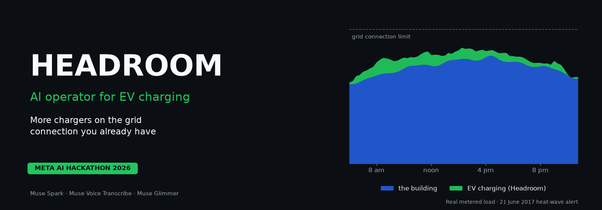

# Headroom

**An AI operator that fits more EV chargers on the grid connection a building already has: no grid upgrade, every driver charged, never over the limit.**

Meta Global AI Developer Hackathon 2026 · Indie track · *Push the Frontier* (energy: controlling a physical system)

**[See how it works](https://headroom-meta.vercel.app/demo/)** · **[Watch the demo video](https://youtu.be/1-Ch1mL8464)** · [Project page](https://headroom-meta.vercel.app/) · [Run it yourself](#run-the-demo-no-key-no-account) · [All results](#results)

## The problem
Offices, malls, campuses and fleet depots all want more EV chargers, and the chargers plug into the same grid connection as the building.
- **The bill.** US utilities bill a business for its highest 15 minutes of power each month. Under Palo Alto's E-4 tariff, one 50 kW charging spike at 6 pm on a summer weekday adds **$2,572** to the bill, for about $3 of electricity.
- **The limit.** Owners size chargers for the worst case: the building's peak plus every charger at full power. So they install fewer chargers, or cap them and waste capacity they already pay for.
- **The upgrade.** More connection capacity means a utility study, a new transformer and a long wait.

## What Headroom does
Headroom sits between the building's meter and its chargers.
- **It watches the building** and charges the cars in the room the building leaves.
- **It never lets the site go over its connection.** A safety layer guarantees the limit.
- **The site manager just asks it questions** in plain language: *"Can I add 12 more chargers? What would it cost me?"* The operator, built on Meta's **Muse Spark**, answers from simulation, with every number checked against the math.
- **If the internet drops,** Meta's open-weight **Muse Glimmer** takes over on site.

| On real data | Result |
|---|---|
| Chargers on the same 1,000 kW connection | **48 instead of 36** (+33%) |
| Drivers' energy delivered | **100%** |
| Demand charges added by charging | **32% lower** than standard smart charging |
| Times the site went over its limit | **0** |
| 49 other real buildings | More chargers in **77%**, fewer in none |
| A second utility (PG&E) | The same **48 instead of 36** |

**Who it's for:** building owners and operators adding EV charging, and the companies that install and run chargers for them.

**What's real and what's simulated:**
- **Real:** the data. Recorded Palo Alto driver sessions, metered building loads, the utilities' published tariffs, grid-alert days.
- **Simulated:** the site that combines them, and the chargers. They are driven over the real OCPP protocol, but not physical hardware.
- This is a research prototype, not a deployed product. No utility or Meta endorsement is implied.

## How it works

1. **See the building.** A forecast of the building's load for the next 24 hours, as calibrated quantiles (an hour-of-day statistical profile; no trained model at runtime).
2. **Plan the charging.** A linear program (HiGHS) re-solved every 15 minutes charges every car under the demand level the month has already paid for, and raises it only by the minimum the drivers' needs require.
3. **Guarantee the limit.** A deterministic safety layer that nothing above it can override keeps the site under its connection limit (fuzz-tested on 10,000 random and adversarial plans). Each decision reaches the chargers as an OCPP 1.6J power limit, the protocol commercial chargers speak.
4. **Muse Spark runs the site.** It reads the utility's tariff (verified on Palo Alto's and PG&E's), takes requests by text or voice, sizes a plan change for a grid alert from the building's own past alert days, spots blocked bays on camera, and answers expansion questions from simulation. It can act only through validated tools, and every number in its answers is checked against the tool results. If the internet drops, **Muse Glimmer** on the site's own GPU takes over; charging never depends on either model.

> The model proposes, the math decides, the safety layer guarantees.

## Meta models used
| Meta model | What it does here |
|---|---|
| **Muse Spark 1.3** (Meta Model API) | The site operator: answers the site manager through checked tools, reads utility tariffs, sizes grid-alert changes, watches the bay camera |
| **Muse Voice Transcribe 1.0** (Meta Model API) | Spoken requests to text |
| **Muse Glimmer** (open weights) | Backup operator on the site's own GPU when the internet is cut |

Details, and how each model's output is checked: [Meta models](#meta-models).

## Results
Held-out test months (May–Oct 2017), real data only; nothing was tuned on them. Same real driver sessions for every controller; 6 months × 3 resampled fleets = 18 month-scenarios per row.

**24 chargers (4× today's garage) on a 1,000 kW connection, E-4 TOU tariff** (`scripts/final_benchmark.py`):

| Controller | Energy delivered | Demand charges added by charging ($/month) | Connection-limit violations |
|---|---|---|---|
| Static cap | 100% | 4,231 | 0 |
| Least-laxity-first (standard smart charging) | 100% | 4,231 | 0 |
| Caltech adacharge MPC (open source, unmodified) | 100% | 4,231 | 0 |
| **Headroom** | **100%** | **2,889 (−32%)** | **0** |
| *Ablation: perfect foresight (upper bound)* | *100%* | *2,595* | *0* |

- **Hosting capacity** (drivers get ≥ 99% of their energy in every month, 0 violations; `scripts/capacity_study.py test`): **48 chargers with Headroom vs 36 with standard smart charging or a static cap (+33%)** on the same connection. At 48, standard smart charging leaves drivers short in 3 of the 18 month-scenarios.
- Headroom captures **82%** of the saving a perfect-foresight controller gets.
- **Stress test** (labelled; added intra-hour variability, σ = 2%): $2,783/month (standard smart charging: $3,903), 100% delivered, 0 violations.
- **Drivers first, as a strict priority.** The planner prices unserved energy above the most a kWh could ever save in demand charges, derived from the tariff (E-4: $309/kWh), so it never trades a driver's energy for a lower bill.
- **Ablations, reported as measured:**
  - A trained LightGBM forecaster in place of the profile changes almost nothing ($2,889.62 vs $2,888.91): the two forecasts agree for the first 4 hours, which is what drives each 15-minute decision. The value is in seeing the building, not in model complexity ([docs/FORECASTING.md](docs/FORECASTING.md)).
  - "Never set a new peak" adds only $326/month but delivers 86% of energy: some charging has to overlap the building's peak, which is why drivers come first.
- The three EV-only baselines coincide at 24 chargers because their fixed 161 kW cap never binds; they separate at higher counts.
- **Forecast calibration** on the test months: P90 covered 86–95% (target 90%), P99 97.7–100% (target 99%).

### Beyond one site: 49 real buildings, median +15% chargers
Headroom Check on 49 metered buildings from BDG2 at 7 US sites (22 education, 8 office, 7 lodging, 5 public services, 4 assembly, 2 parking, 1 services). They are a quality-filtered, fixed-seed sample, screened on held-out Jul–Aug 2017 with real Palo Alto sessions (`scripts/portfolio_study.py`):

| | Result |
|---|---|
| Buildings where Headroom fits more chargers on the same connection | **77%** (fewer in none) |
| Median gain per building | **+15%** (95% bootstrap CI +10% to +45%; IQR +2% to +61%) |
| Chargers in total, standard smart charging → Headroom | 2,225 → 3,010 (+35%) |
| Grid-limit violations at the reported charger counts | **0** |

- **Where the gain comes from.** A fixed cap has to keep room for the building's rarest peak all year; Headroom only holds that room back when the peak is coming. So the gain is largest where the peak is brief:
  - In the third of buildings that spend at most 20 hours a year within 10% of their peak, the median gain is **+82%**.
  - In the other two thirds it's about +10%.
  - This is exploratory: 6 building traits were tested, and this one has ρ = −0.34, p = 0.03.
- **Gains vary widely.** No change in 10 of 44 buildings, +50% or more in 14, more than double in 6 (e.g. 22 → 76 chargers).
- **Our main site isn't an outlier.** Its +33% is better than 61% of these 44 buildings.
- In 5 small or very spiky buildings neither controller can guarantee room for even 2 chargers.
- **The connection size is estimated, so we tested a tighter one.** BDG2 doesn't record connection sizes; the main study uses peak ÷ 0.8 (the electrical code's continuous-load rule). With a tighter connection (peak ÷ 0.9), Headroom's advantage grows:
  - median **+31%** (95% CI +12% to +143%);
  - more chargers in 79% of buildings, fewer in none; +52% in total;
  - 0 violations at the reported sizes (`PORTFOLIO_SHARE=0.9`, `portfolio_summary_share90.csv`).
  - The tighter the connection, the more seeing the building matters.
- Honest caveats:
  - In 6 buildings the test months contained a load rise larger than any in the building's past year (16 intervals in all). Fleet sizes where this caused a violation were rejected (6 simulated months).
  - Our main site (+33%) is excluded from these figures.
  - Every building is paired with the same Palo Alto driver sessions, so the result doesn't depend on any one building–garage pairing.

### Another utility's tariff: PG&E B-19
The same site and the same held-out months, billed instead on PG&E's Schedule B-19 (secondary voltage, effective 1 March 2026). B-19 is the standard large-commercial tariff of a different utility, with different periods and charges: peak every day including weekends, and a part-peak demand charge. Muse Spark read the official schedule 21/21 fields right, with every bill reproduced exactly (the two Palo Alto tariffs: 15/15 each). Run with `TARIFF=pge-b-19_2026`:

| 24 chargers, PG&E B-19 | Energy delivered | Demand charges added by charging ($/month) | Violations |
|---|---|---|---|
| Static cap / standard smart charging / adacharge MPC | 100% | 6,165 | 0 |
| **Headroom** | **100%** | **5,030 (−18%)** | **0** |
| *Ablation: perfect foresight* | *100%* | *4,828* | *0* |

- Headroom captures **85%** of the saving a perfect-foresight controller gets (82% under E-4).
- The saving is smaller than under E-4 for a clear reason. B-19 bills $37.37/kW on the month's peak at *any* hour, on top of the evening window, so there is less to gain by avoiding the evening alone.
- The planner needed no change: its drivers-first priority derives itself from the tariff ($564/kWh under B-19).
- **Hosting capacity is the same under B-19: 48 chargers with Headroom vs 36** with standard smart charging or a static cap, 0 violations. At 48, standard smart charging leaves drivers short in 3 of 18 month-scenarios (`capacity_summary_test_pge-b-19_2026.csv`).

### Driving real chargers: OCPP 1.6J
Headroom's decisions leave the simulator as **OCPP 1.6J `SetChargingProfile` commands**, the open protocol commercial chargers use for power limits (`headroom/ocpp_bridge.py`).
- **What it sends:** every 15 minutes, each charger gets an absolute limit in watts for that interval.
  - An idle charger gets 0 W, so a new car waits for the next decision instead of adding unplanned load.
  - The limit expires with the interval, so if the controller goes quiet, chargers fall back to their installed safe default.
- **Test** (`scripts/ocpp_demo.py`): the real plan for the heat-wave evening (21 June 2017, 4–9 pm) is sent to 24 simulated chargers over local websockets.
  - 480 commands, **480 accepted**.
  - **0 W** difference between planned and received limits.
  - Each interval's total matches the simulation exactly.
  - All 24 chargers are updated in under 0.1 s.
- **What's still missing:** the chargers are simulated, so a pilot on real hardware is the next step. Messages are built and schema-checked by the open-source `ocpp` library.

## Meta models
| Model | Where it runs | Job in Headroom | How its output is checked |
|---|---|---|---|
| **Muse Spark 1.3** | Meta Model API | Site operator (tool-calling agent); tariff document → structured rates; grid-alert sizing; bay video → occupancy | Tool calls validated against strict schemas; every number in an answer traced to a tool result; tariff accepted only if it reproduces the real bills; bays count as blocked only if the charger also reports no power |
| **Muse Voice Transcribe 1.0** | Meta Model API | Spoken requests → text for the operator | The transcript is shown to the user before anything runs |
| **Muse Glimmer** (open weights, Apache-2.0) | The site's own GPU (Ollama); demo answers recorded on a Kaggle T4 | Backup operator when the internet link is down | Same tools, same validation, same number check |

Every model called at runtime is a Meta model; the planner (a linear program) and the forecast (a statistical profile) are not models. Each recorded model call (request, response, tokens, time) is in [`data/recordings/`](data/recordings/) and listed on the app's *Proof* page; the demo replays them, so it runs without any account or key.

## Run the demo (no key, no account)
```powershell
python -m venv .venv
.\.venv\Scripts\python.exe -m pip install -r requirements.lock.txt
.\.venv\Scripts\python.exe -m streamlit run app.py
```
- **Start** explains what you give and what you get; **Watch it run** plays the real heat-wave day decision by decision; **Ask the operator** replays the recorded Muse Spark conversation; **What the camera sees** shows Muse Spark checking the bays step by step; **Check your building** answers for a sample building (or your own meter export); **How the AI is checked** and **Proof and data** show the verifiers and every result.
- On **Ask the operator**: **Send this voice request** plays a recorded spoken request through Muse Voice Transcribe and Muse Spark (the audio, [`data/voice/question.wav`](data/voice/question.wav), was voiced with a built-in system synthesiser, not a model; [`scripts/record_voice.py`](scripts/record_voice.py) recorded both calls). **Cut the internet** turns the cloud models off and Muse Glimmer answers on site.
- **Model calls: Live** calls the models.
  - It appears only when `MODEL_API_KEY` (Meta Model API) is set in `.env`; see `.env.example`. Without a key, the app replays the recorded answers.
  - Keys live only in `.env`, which is never committed. Don't set a key on a public deployment.
  - A hard spend guard in `headroom/meta/client.py` refuses any call that could take the total past the budget.
- Each visitor gets their own copy of the simulated site, so one visitor's questions never change another's.

**Host it (Streamlit Community Cloud, free):**
1. Sign in at share.streamlit.io with GitHub and choose **Create app**.
2. Pick this repo, branch `main`, main file `app.py`. Under **Advanced settings**, pick Python 3.12.
3. Deploy. It installs `requirements.txt`, the slim app-only list.
4. Add no secrets. Without a key the hosted app replays the recorded answers and costs nothing.

## Data (real recorded data only)
| Source | Use |
|---|---|
| City of Palo Alto open data: WEBSTER garage charging sessions, 2016–2017 (6 ports) | Every car's arrival, departure and energy. Larger garages re-use real recorded port-days (same day type, ±7 days) |
| Building Data Genome 2 (Miller et al., *Scientific Data* 7, 368, 2020): UC Berkeley `Bear_education_Patricia` | The building sharing the connection; hourly → 15-minute with an energy-preserving split |
| BDG2, other US sites | The multi-building study (quality-filtered, fixed-seed sample) |
| City of Palo Alto Utilities E-4 TOU and E-7 TOU tariffs (2026); PG&E Schedule B-19 (effective 1 March 2026) | Bills; hand-checked gold copies for the tariff verifier |
| CAISO Flex Alert dates | Grid-stress events |

Preprocessing only transforms real data (time zones, cleaning, ≤ 3 h gap filling, the energy-preserving split). Details and every count: [docs/DATA_SPEC.md](docs/DATA_SPEC.md), `data/processed/REPORT.md`.

## Assumptions and limits
- Simulation on recorded data, not a live site: the building and the garage are real but from neighbouring cities, sharing an assumed 1,000 kW connection. The 49-building study pairs the same sessions with many real buildings. The control path to chargers is tested over OCPP against simulated chargers, not real hardware.
- 2026 prices on 2016–2017 behaviour. Tariffs: Palo Alto (CPAU) E-4 and E-7, and PG&E B-19, a different utility with different periods. All three are read by Muse Spark and verified.
- In the multi-building study the connection size isn't in the data: estimated as the peak before the screened months ÷ 0.8 (the electrical code's continuous-load rule), with a tighter ÷ 0.9 sensitivity case.
- The simulation steps in 15 minutes, so the safety layer keeps an allowance for the building's load rising before the next reading. It budgets against the building's highest reading of the past 3 hours (riding through meter dropouts) plus an allowance sized from that building's own past year (largest rise + 20%; 60 kW for the main building). The guarantee holds whenever a rise stays within that allowance, and every run reports any rise that didn't. A real deployment would read the meter every few seconds.
- The bay camera demo uses public-domain parking-lot footage with bays marked for illustration.

## Built during the hackathon, and what isn't ours
**Built during the hackathon (Oct 26 – Nov 4, 2026; git history from Oct 27):** everything in `headroom/`, `scripts/`, `tests/` and `app.py`: data pipeline, simulator, safety layer, Headroom's planner, forecasts, transformer model, tariff reader and verifiers, operator agent and tools, number check, failover, Headroom Check and the studies, and the app.

**Third-party, used unmodified as libraries:** [adacharge](https://github.com/caltech-netlab/adacharge) and [acnportal](https://github.com/zach401/acnportal) (Caltech; the adacharge MPC baseline), HiGHS (via SciPy), CVXPY/Clarabel (for adacharge), LightGBM (ablation only), [ocpp](https://github.com/mobilityhouse/ocpp) and websockets (the charger protocol), Streamlit, Plotly, pandas, NumPy, pydantic, the OpenAI Python SDK (as the client for Meta's OpenAI-compatible API).

**Prior work:** the forecasting idea (an hour-of-day baseline improved by gradient boosting) follows our 2025 IndiaAI hackathon entry; no code from it is used. Our first commit (`b85b2e1`) accidentally included that 2025 notebook and its write-up; they were removed in `cc2d789` and nothing in Headroom uses them.

## Reproduce the results (Windows, Python 3.12)
```powershell
.\.venv\Scripts\python.exe scripts\fetch_data.py                 # raw data (BDG2 is 167 MB)
.\.venv\Scripts\python.exe -m headroom.data.pipeline             # data/processed (~5 s)
.\.venv\Scripts\python.exe -m pytest -q                          # invariants, safety fuzz test, agent and verifier tests
.\.venv\Scripts\python.exe scripts\precompute_forecasts.py 2017-05 2017-06 2017-07 2017-08 2017-09 2017-10
.\.venv\Scripts\python.exe scripts\final_benchmark.py            # the table above (~20 min)
.\.venv\Scripts\python.exe scripts\capacity_study.py test        # hosting capacity (~25 min)
.\.venv\Scripts\python.exe scripts\portfolio_study.py select     # the multi-building sample
.\.venv\Scripts\python.exe scripts\portfolio_study.py run        # the multi-building study (hours)
.\.venv\Scripts\python.exe scripts\portfolio_study.py drivers    # which building traits go with a larger gain
$env:PORTFOLIO_SHARE="0.9"; .\.venv\Scripts\python.exe scripts\portfolio_study.py run   # tighter connection
$env:TARIFF="pge-b-19_2026"; .\.venv\Scripts\python.exe scripts\final_benchmark.py      # under PG&E B-19
.\.venv\Scripts\python.exe scripts\ocpp_demo.py                  # the plan sent to 24 chargers over OCPP 1.6J
.\.venv\Scripts\python.exe scripts\export_demo.py                # data for the web demo (docs/demo/data.json)
.\.venv\Scripts\python.exe scripts\make_landing.py               # the landing page (docs/index.html)
```
Long studies can also run on Kaggle's free machines: `python scripts/kaggle_run.py study` (see the script).

## Code layout
- `headroom/data/`: datasets → one 15-minute site table
- `headroom/tariff.py`: tariffs as data, and the monthly bill
- `headroom/sim/`: scenarios on real sessions; the 15-minute simulator with the safety layer
- `headroom/control/`: Headroom's planner and the baselines
- `headroom/forecast/`: hour-of-day profile (runtime), LightGBM blend (ablation), walk-forward files
- `headroom/check.py`: Headroom Check for any building's meter data
- `headroom/ocpp_bridge.py`: decisions → OCPP 1.6J charging profiles; a simulated charger for tests
- `headroom/thermal.py`: IEEE C57.91 transformer ageing
- `headroom/agent/`: operator agent, tools, number check, tariff reader, bay check, the replay site
- `headroom/meta/client.py`: Meta model client with record/replay, failover and the spend guard
- `scripts/`: benchmark, capacity and multi-building studies, forecasts, demo recording, data download
- `docs/`: [FORECASTING](docs/FORECASTING.md), [DATA_SPEC](docs/DATA_SPEC.md), [DATA](docs/DATA.md), [GLIMMER_KAGGLE](docs/GLIMMER_KAGGLE.md)

## License
Code: [MIT](LICENSE). Data, under their publishers' terms:
- Building Data Genome 2: CC-BY 4.0 (Miller et al., 2020).
- Palo Alto open data: downloaded from the city portal by `scripts/fetch_data.py`, not redistributed.
- The utilities' published tariffs.
- Public-domain parking-lot video.

Details: [docs/DATA_SPEC.md](docs/DATA_SPEC.md). Muse Glimmer's weights are Apache-2.0 (Meta).
